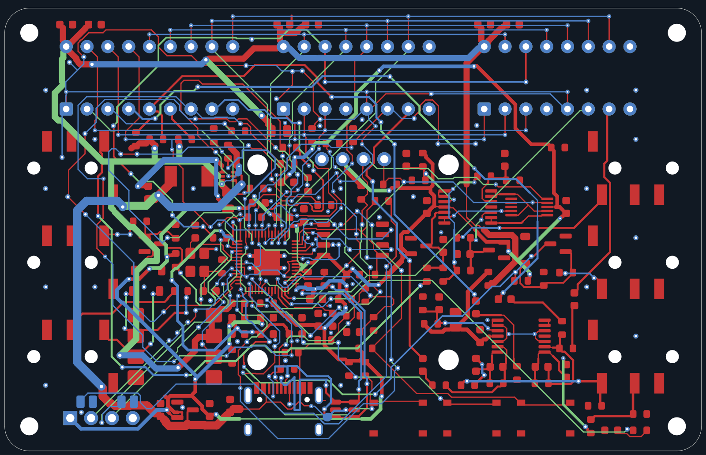

# Chiptune USB/CV

SAA1099 × 1、SN76489AN × 2、RP2040を搭載した小型チップチューン音源のハードウェアプロジェクトです。
USB MIDI、TRS MIDI、2系統のCV／ゲート入力と、OLED・3ボタンによる操作を想定しています。
回路図、配線済みPCB、JLCPCB向け製造データ、設計資料を収録しています。

**開発状況:** PCBの配線と設計ルール検査は完了しています。実機ファームウェアと組み立て後の動作検証は開発中です。



## 仕様

| 項目 | 内容 |
|---|---|
| 基板 | 85 × 54 mm、4層、FR-4 1.6 mm、角R3、M2用取り付け穴 |
| マイコン | RP2040、外部QSPIフラッシュ |
| 音源 | SAA1099 DIP18 × 1、SN76489AN DIP16 × 2 |
| 電源 | USB-C給電 |
| MIDI | USB MIDIデバイス、3.5 mm TRS Type A入力 |
| CV | 1 V/oct入力 × 2、系統別の2点校正を想定 |
| ゲート | 0–5 V／0–10 V入力 × 2 |
| オーディオ | 3.5 mmステレオライン出力、入力インピーダンス10 kΩ以上の外部アンプ向け |
| 操作 | 0.96インチ128 × 64 OLED、3ボタン |

## リポジトリ構成

| ディレクトリ | 内容 |
|---|---|
| `routed/` | 配線済みKiCadプロジェクト、シンボル、フットプリント |
| `hardware/` | 回路・配置生成用の未配線プロジェクト |
| `firmware/` | GPIO定義と音源バス書き込みヘルパー |
| `docs/` | 回路仕様、操作設計、配線ルール |
| `scripts/` | 設計生成、配置、配線、検証、製造データ出力用スクリプト |
| `outputs/jlc-one/` | JLCPCB向け提出ファイルと組み立て資料 |
| `outputs/assembly-review/` | 実装座標・ピン1・極性の照合資料 |
| `outputs/review/` | 基板図とUIモックアップ |
| `research/` | 部品カタログ属性と実装ライブラリ参照図 |
| `variants/` | 設計比較用の基板データ |

## KiCadで開く

[`routed/Chiptune_USB_CV.kicad_pro`](routed/Chiptune_USB_CV.kicad_pro) を開いてください。
製造用のPCBは同じディレクトリの `Chiptune_USB_CV.kicad_pcb` です。

KiCad 9.0.9で作成しています。シンボルとフットプリントは同梱し、`${KIPRJMOD}`から参照します。
一部の3DモデルにはKiCad標準ライブラリが必要です。

## 製造データ

[`outputs/jlc-one/upload/`](outputs/jlc-one/upload/) にJLCPCB／JLCONE向けの提出ファイルがあります。

| ファイル | 用途 |
|---|---|
| [`Chiptune_Gerber.zip`](outputs/jlc-one/upload/Chiptune_Gerber.zip) | 基板製造データ |
| [`Chiptune_BOM.csv`](outputs/jlc-one/upload/Chiptune_BOM.csv) | 部品表・LCSC部品番号 |
| [`Chiptune_CPL.csv`](outputs/jlc-one/upload/Chiptune_CPL.csv) | 表面実装座標・回転角 |

Gerber ZIP、BOM、CPLをそれぞれ対応する欄へ指定します。
[製造資料一式のZIP](outputs/Chiptune_JLC_ONE_Public.zip) は展開し、内部の提出ファイルを使用してください。

表面実装対象は141点、BOMは41行・40品種です。
音源ICとDIPソケット、OLEDモジュール、任意のSWDヘッダーは手実装します。
組み立て手順と製造条件は [`outputs/jlc-one/README.txt`](outputs/jlc-one/README.txt) を参照してください。
発注時は部品在庫と実装プレビューのピン1・極性・向きを確認してください。

## 開発状況

- 基板検査: DRC 0、未接続0、回路図との一致問題0、ERC 0。
- 設計照合: 152フットプリントの配置・端子接続と、音源バスの768ケースを検査済み。
- ファームウェア: GPIO定義と音源書き込みヘルパーを収録。USB MIDI、CV／ゲート処理、OLED UI、設定保存は未実装。
- 実機検証: 電源電流・突入電流、音声出力、CV校正、取り付け公差の評価は未完了。

[`UIモックアップ`](outputs/review/chiptune-ui.html) は画面構成と操作の確認用です。

## 検証コマンド

Ubuntu上のKiCad CLIと、`pcbnew`を利用できるPython環境を使用します。
画像出力にはCairoSVGが必要です。

```bash
kicad-cli pcb drc --format json --schematic-parity --exit-code-violations \
  -o outputs/drc-routed.json routed/Chiptune_USB_CV.kicad_pcb
kicad-cli sch erc --format json --exit-code-violations \
  -o outputs/erc-routing.json routed/Chiptune_USB_CV.kicad_sch
/usr/bin/python3 scripts/check_routing.py
/usr/bin/python3 scripts/check_bus_encoding.py
```

検証レポートは `outputs/`、製造パッケージの検査結果は `outputs/jlc-one/checks/` にあります。
配置・配線の再生成スクリプトはKiCadファイルを書き換えるため、設計変更用のブランチで実行してください。

## 設計資料

- [回路仕様・操作設計](docs/USB-CV-design-notes.txt)
- [配線方針・線幅](docs/routing-notes.txt)
- [実装ライブラリの照合記録](outputs/assembly-review/Assembly_Review.txt)
- [ピン1・極性の参照図](outputs/assembly-review/Placement_Pin1.png)
- [部品ライブラリ・資料の出典](THIRD_PARTY_NOTICES.md)
