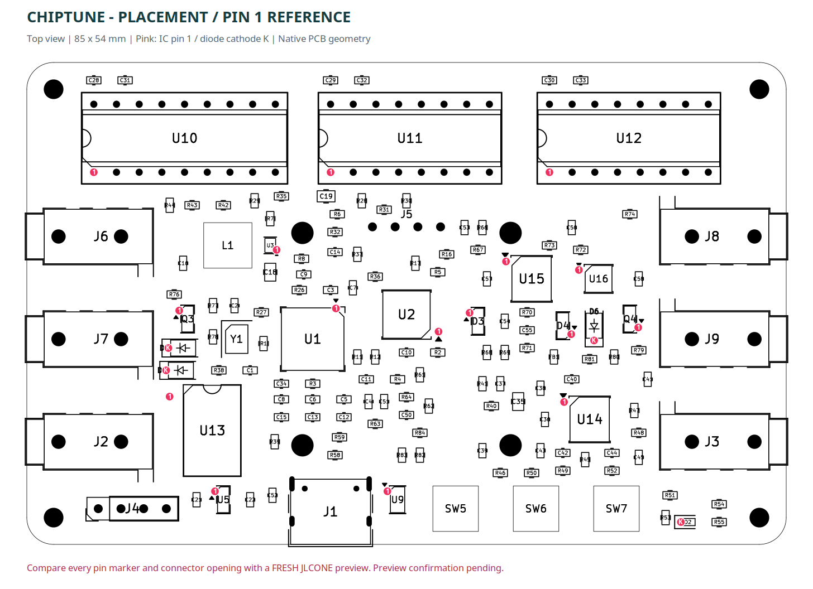

# Chiptune USB/CV

SAA1099 × 1 と SN76489AN × 2 を使う、85 × 54 mmのチップチューン音源ガジェットの設計資料です。
現在の版はRP2040、USB-C給電／USB MIDIデバイス、TRS MIDI入力、CV入力2系統＋ゲート入力2系統です。


## 現在の仕様

| 項目 | 内容 |
|---|---|
| PCB | 85 × 54 mm、角R3、角R中心のM2用穴、4層、FR-4 1.6 mm |
| MCU | RP2040、外部QSPIフラッシュ |
| 音源 | SAA1099 DIP18 × 1、SN76489AN DIP16 × 2、ソケットで手実装 |
| MIDI | USB MIDIデバイス入力、3.5 mm TRS Type A入力 |
| CV / gate | CV 1 V/oct × 2、ゲート0–5 V／0–10 V × 2 |
| 音声 | 3.5 mmステレオライン出力、外部アンプ等への接続 |
| UI | 0.96インチOLEDと3ボタン。画面は操作見本、実機FWは未完成 |
| 電源 | USB-C。電池・USBホスト・PCM5102は現在の版では使用しない |

## 開くファイル

- **配線済み原本:** [`routed/Chiptune_USB_CV.kicad_pro`](routed/Chiptune_USB_CV.kicad_pro)
- 配置・回路の元データ: `hardware/`（未配線。製造には使用しない）
- 設計仕様・操作: [`docs/USB-CV-design-notes.txt`](docs/USB-CV-design-notes.txt)
- 線幅・配線方針: [`docs/routing-notes.txt`](docs/routing-notes.txt)
- 部品／実装レビュー: [`outputs/assembly-review/Assembly_Review.txt`](outputs/assembly-review/Assembly_Review.txt)
- UI操作見本: [`outputs/review/chiptune-ui.html`](outputs/review/chiptune-ui.html)

KiCad 9.0.9で作成。シンボル・フットプリントはプロジェクトに同梱し、`${KIPRJMOD}`から参照します。
3Dモデルの一部はKiCad標準ライブラリのインストールが必要です。

## JLCPCB / JLCONEへの提出

[`outputs/jlc-one/upload/`](outputs/jlc-one/upload/) の次の3点を、それぞれ対応する欄に指定します。

1. `Chiptune_Gerber.zip` — このZIPを展開せず基板データとして提出
2. `Chiptune_BOM.csv` — メーカー型番・LCSC番号を含む部品表
3. `Chiptune_CPL.csv` — 表面の実装座標・部品別の回転／原点補正

[提出用まとめZIP](outputs/Chiptune_JLC_ONE_Public.zip) は保管・受け渡し用です。外側のZIPをそのまま基板欄に指定しないでください。
表面実装141点、BOM41行・40品種。OLED、音源IC／DIPソケット、任意のSWDヘッダーは手実装です。
J1のUSB-Cも調達・実装対象です。My Partsに使用可能在庫がある場合は利用でき、新規調達は同じC165948を選択します。



ピンクの「1」は設計上の1番ピン、「K」はカソードです。ビュワー側の色付き点と同じ意味ではありません。
新しいプレビューの外形・リード位置は整合し、ユーザーは配置を確認済みです。
U1/U13/U16のピン1印は画像で一致を確認。U2/U3/U9/U14/U15は印を独立して判別できず、製造前に最終確認が必要です。
部品在庫・価格・実装対象は注文時に確認してください。

## 検証と残作業

KiCadのDRC 0、未接続0、回路図との一致問題0、ERC 0。
152フットプリントの座標・端子ネットを元データと照合し、音源バスの768ケースを検査しています。
レポートは `outputs/*verification.json`、`outputs/drc-routed.json`、`outputs/erc-routing.json` にあります。

実機ファームウェアは未完成です。`firmware/pinmap.h` と `sound_bus.h` はGPIO定義・音源書き込みヘルパーで、完成したUSB MIDIアプリではありません。
電源電流・突入、音声出力、CV校正、組み立て公差の実機検証は未完了です。
この公開スナップショットから発注・支払いは行っていません。

## 作業用スクリプト

Ubuntu上のKiCad CLIと `/usr/bin/python3` の `pcbnew` を使用します。

```bash
kicad-cli pcb drc --format json --schematic-parity --exit-code-violations \
  -o outputs/drc-routed.json routed/Chiptune_USB_CV.kicad_pcb
kicad-cli sch erc --format json --exit-code-violations \
  -o outputs/erc-routing.json routed/Chiptune_USB_CV.kicad_sch
/usr/bin/python3 scripts/check_routing.py
/usr/bin/python3 scripts/check_bus_encoding.py
/usr/bin/python3 scripts/package_jlc_one.py
```

PNGの生成にはCairoSVGを使用。その他の配置・ルーティングスクリプトは開発履歴として保存しています。
再生成・配線実験はコピーで行い、配線済み `routed/` を上書きしないでください。
部品カタログは再出力に必要な公開属性のみ保存し、WebページのキャッシュとメーカーPDFは除いています。

## 設計の経緯

- 当初は単4電池2本、USBホスト／デバイス切替を検討。
- USB給電・USB MIDIデバイス専用に変更し、OLED UIとCV／ゲート2系統を追加。
- 信号の流れに合わせて配置を整理し、四隅をR3・穴を角R中心へ統一。
- 信号別の線幅を定義し、4層で配線を完了。
- D2を赤0603 C2286、Q3/Q4をSOT-23 C20526のBasic品へ変更。
- 全実装ICとジャック・USBのライブラリ原点を照合し、CPLを補正。

注文表・個人のスクリーンショット・ブラウザキャッシュ・大量の途中配線結果は公開対象に含めていません。
部品図・KiCadライブラリの出典は [`THIRD_PARTY_NOTICES.md`](THIRD_PARTY_NOTICES.md) を参照してください。
