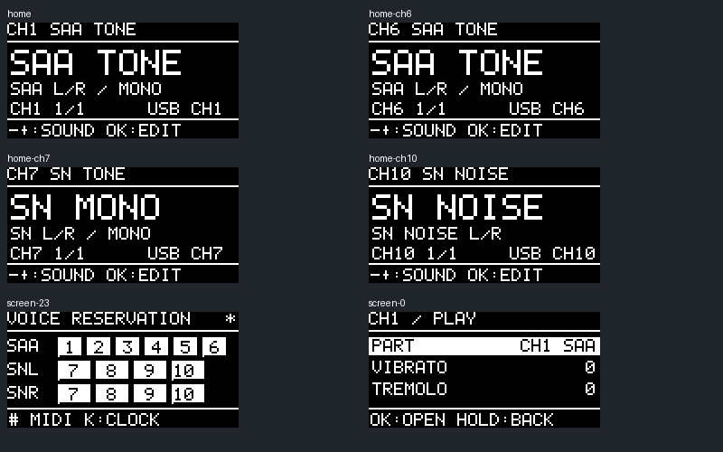

# Chiptune USB/CV firmware v0.9.0-alpha

SAA1099＋SN76489AN×2を、**MIDI 1ch＝1音**で演奏します。初期プロファイルは **MIDI 10**。音量を回路の公称値で補正し、初期音色と画面の対応を整理しました。

[UF2をダウンロード](dist/chiptune-v0.9.0-alpha.uf2) ／ [Wave Labエディタ](https://bongorian.github.io/chiptune-usb-cv/) ／ [音量・周波数の根拠と測定方法](LEVELS_AND_PITCH.md)

## 初期配置：この表で弾く

USB MIDIとTRS MIDIは同じ割り当てです。各chは単音で、後から受けたノートを優先します。

| MIDI ch | 音源・内部回路（1始まり） | 出力 | 初期音色 |
|---|---|---|---|
| 1–6 | SAAトーン1–6、それぞれ1音 | ステレオ、PAN対応 | SAA TONE |
| 7 | 左右SNのトーン1 | 同じ音程をL/Rへ | SN MONO |
| 8 | 左右SNのトーン2 | 同じ音程をL/Rへ | SN MONO |
| 9 | 左右SNのトーン3 | 同じ音程をL/Rへ | SN MONO |
| 10 | 左右SNのノイズ | L/Rへ同じノイズ設定 | SN NOISE |
| 11–16 | 未割り当て | — | — |

**SNのPAN中央は左右同音量、CC10でL/Rへ振ります。** SAAもCC10でPANを変更できます。SNの2つのICは発振位相・ノイズ系列まで同期を保証するものではありません。初期デチューン・スイープ・ビブラートは0。全chを同時に演奏できます。CV/Gate・シーケンサー・アルペジオ・クロックFXは初期OFFです。

MIDI note 69=A4=440 Hz。試聴はnote 45=A2=110 Hzへ下げました。受信MIDIを一律に移調しません。[128ノートの周波数表](dist/Pitch_Table.csv)に実レジスターと誤差を記録しています。SAAの通常音程はMIDI 23–118、SNは初期2 MHzで35以上がハードウェア範囲内です。範囲外は端の周波数へクランプします。

## 書き込みと最初の操作

1. 専用基板をBOOTSELへ入れ、`RPI-RP2`へUF2をコピー。−／＋を押しながらUSB接続、または `SYSTEM > USB UPDATE` で入れます。
2. USBを抜いてボタンを押さずに接続。J3 LINE OUTを10 kΩ以上の入力へ接続し、上のMIDI chへノートを送ります。
3. OK長押し → `EDIT CHANNEL` で編集するchを選択。短いOKでSOUND。−／＋で音色選択。
4. `TOOLS / AUDITION` のTESTで試聴。TEST NOTEにノート名とHzを表示します。RESOURCE MAPの数字は受信MIDI ch、Kはクロック専用回路です。

| 操作場所 | −／＋ | 短いOK | OK長押し（約0.7秒） |
|---|---|---|---|
| ホーム | 音色選択 | SOUNDへ | メニュー |
| 一覧 | 選択 | 開く／編集 | 戻る |
| 値の編集 | 値を変える | 確定 | 取消 |
| 確認 | NO／YES | 実行 | 取消 |

−／＋を約0.9秒同時長押しするとPANIC。全発音・試聴・シーケンスを停止します。

## 特殊な音はプロファイルを選ぶ

`OK長押し > PARTS / SETUP > PROFILE > APPLY PROFILE`。**全パートとMIDIルートが置き換わり、演奏を停止します。** 保存するまではRAM内の変更です。普通に10 chで弾く場合はMIDI 10を使います。

| プロファイル | 特殊発音するMIDI ch | その他の発音 |
|---|---|---|
| MIDI 10（初期） | なし。各chが単音 | ch1–6 SAA、ch7–9 SN、ch10 SNノイズ |
| HYBRID | **ch2：SAA ENV/AM、最大2声** | ch1 SAA通常2声、ch3 SN2声、ch10 SNノイズ1声 |
| SAA POLY | ch1：SAA通常6声 | ch3 SN2声、ch10 SNノイズ1声 |
| DUAL LAYER | **ch1：SAA LAYER、最大2声** | ch3 SN2声、ch10 SNノイズ1声 |
| PERCUSSION | **ch2：SAA ENV 1声、ch11：SAAノイズ2声** | ch1 SAA通常2声、ch3 SN2声、ch10 SNノイズ1声 |

HYBRIDのch2ではENV LEAD／AM BELL／ENV HISS／ENV GRITを選べます。SN STACKはHYBRIDなどのch3で使用します。3組STACKとトーン3連動ノイズは競合します。MIDI 10でch10をKEY TRACK/METALへ変える場合もch9のトーンと競合するため、先にch9をOFFにするなど空きを作ります。成立しない変更は拒否します。他chの予約を自動で奪いません。

SAA ENVの出力は内部3／6、クロックは2／5です。純ENVの音程は段数と波形に依存し、16段三角の上限は約488 Hzです。ノイズのMIDIノートは楽音の基音ではなく色の入力になる場合があります。[発音構造と予約の詳細](SOUND_DESIGN.md)を参照してください。



## 音色編集と保存

SOUNDからAMP ENVELOPE（ADSR/PAN）、STRUCTURE、VOICE / PITCH、MACROS / LFOを開きます。23工場音色、16 USER音色、8セットアップがあります。初期のSAA TONE／SN MONO／SN NOISEはF21–23。SN MONOは同音程をL/Rへ出す初期音色で、PANを使えます。SN TWINの構造でDETUNEを追加すれば左右に音程差を付けられます。

`SAVE SOUND`でUSER枠と音色名を指定し、YESで確定。音色と**現在の全パートのセットアップ**を同時保存します。別セットアップへ保存する場合は `PARTS / SETUP > SAVE / LOAD SETUP`。自動保存はありません。

Program Change 0–15はUSER 1–16。パートの音源役割に合う音色だけを読み込みます。CC7=音量、CC10=PAN、CC11=Expression、CC16–19=マクロ。Pitch Bend、RPN 0、サステイン、ベロシティにも対応します。USB/TRSの同音ノートは入力元を区別します。

## 更新で引き継ぐもの

v0.8の保存形式v6・旧配置revision 2からは、**USER音色・CV校正・明るさを保持**し、8セットアップの配置・ルート・クロックをMIDI 10へ初期化します。古い配置を保存し直す前に必要なら音色・設定を控えてください。v0.7以前の音色・演奏設定は工場状態へ移行し、CV校正と対応版の明るさを保持します。

移行はRAM内で行い、起動時のフラッシュ書き込みはありません。明示的なSAVEまで旧設定バンクを残します。revision 3を保存した後の起動ではユーザー設定を保持します。UF2は末尾64 KiBの設定領域を含みません。v0.8.0の起動停止修正は継承しています。[復旧手順](BOOT_RECOVERY.md)／[Androidからの更新](ANDROID_UPDATE.md)。

## ビルドと検証

```sh
cmake -S firmware -B build/tests -DCHIPTUNE_HOST_TESTS=ON -DCMAKE_BUILD_TYPE=Debug
cmake --build build/tests -j4
ctest --test-dir build/tests --output-on-failure
build/tests/editor_export > editor/factory.json
build/tests/pitch_export > firmware/dist/Pitch_Table.csv
EDITOR_BRIDGE="$PWD/build/tests/editor_bridge" node --test editor/tests/*.test.js
bash firmware/tools/bootstrap_sdk.sh .deps/pico-sdk
cmake -S firmware -B build/firmware -DPICO_SDK_PATH="$PWD/.deps/pico-sdk" -DCMAKE_BUILD_TYPE=Release
cmake --build build/firmware -j4
python3 firmware/tools/verify_build.py build/firmware --output build/firmware/Verification.json
python3 -m pip install -r firmware/tests/requirements-arm.txt
python3 firmware/tests/check_arm_boot.py build/firmware/chiptune.elf --output build/firmware/Boot_Verification.json
```

Pico SDK 2.3.1。保存形式v6、配置revision 3。専用RP2040基板向けで、Pico/Pico W/RP2350用ではありません。ASan/UBSan付きPCテストとARM/UF2検証は実機評価と区別します。**音量補正は公称回路モデルによる推定で、実機の音声・USB・OLED・CVの確認は未完了です。** [検証記録](dist/Verification.json)／[実機確認項目](BRINGUP.md)。
