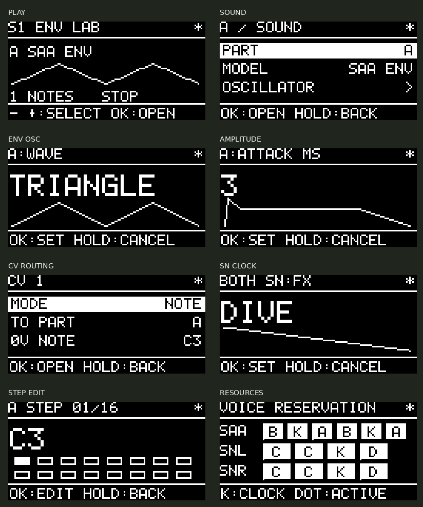

# Chiptune USB/CV firmware v0.5.1-alpha

RP2040、SAA1099、SN76489AN×2、128×64 OLEDを搭載した専用基板用のファームウェアです。3ボタンから、音作り・試聴・MIDI/CV/Gate割り当て・パターン編集・保存・USB更新モードへの移行を操作できます。

v0.5.1は、音源/CV処理がOLEDの実行枠を使い切ると画面更新が止まり得る問題への修正版です。CVのポーリングを1kHzに制限し、音程クオンタイズをNOTE入力のみに行い、OLEDとADCの処理枠を最大4msの待ち時間で再確保します。OLEDの通信失敗後は明るさを含めて再初期化します。v0.5.0で画面が出ず、v0.4.0では表示される実機報告があります。修正版の実機での表示復旧は確認待ちです。

- [UF2](dist/chiptune-v0.5.1-alpha.uf2)
- [Androidからの更新](ANDROID_UPDATE.md)
- [ビルド検証](dist/Verification.json)／[テスト記録](dist/Test_Verification.json)
- [実機確認項目](BRINGUP.md)

RP2040専用です。Pico/Pico Wの端子配列用やRP2350用ではありません。今回の版の実機発音・OLED・Android更新は未確認です。波形図は設定から計算する模式図で、アナログ出力の測定表示ではありません。

## 操作

| 状態 | − / ＋ | OK | OKを約0.7秒長押し |
|---|---|---|---|
| ホーム | 6つの入口を選択 | 開く | — |
| 一覧 | 前 / 次の項目 | 開く・編集 | 一つ戻る |
| 編集 | 値を変更 | 確定 | 変更を取り消す |
| ステップ選択 | 前 / 次のステップ | 値の編集へ | 一つ戻る |

−/＋は長押しで連続移動・連続変更します。広い範囲の数値は長押し時間に応じて加速します。音量・ADSR・波形・変調などは編集しながら反映され、取り消すと元の値に戻ります。音源モデル・声数・有効化・ノイズクロックのように予約資源が変わる設定は、OKでの確定時に適用します。

−と＋を約0.9秒同時長押しすると、PANICで全発音・試聴・シーケンスを停止します。同時押しの離し際に個別のクリックは発生しません。`PLAY > ALL NOTES OFF`も同じ操作です。停止時にHighだったGateは、一度Lowになるまで再発音しません。

`*`は未保存、`T`は試聴中を示します。編集を取り消しても、すでに進んだ発振位相や発音の時間までは巻き戻しません。

## 最小の音出し

1. USBで給電し、右下のJ3（LINE OUT）をアンプなどへ接続します。
2. ホームの`PLAY`をOKで開き、`PART A`を選びます。
3. `TEST`を`REPEAT`にしてOKで確定します。初期音色のSAA ENVがC3で繰り返し鳴ります。
4. `TEST=OFF`またはPANICで停止します。

`SINGLE`は約400msのノートを一度、`REPEAT`は約1秒周期、`HOLD`は停止するまで保持します。試聴ベロシティは80です。`TEST NOTE`で音程を変更できます。長いアタックの確認には`HOLD`を使います。試聴中にSOUNDを編集することもできます。PARTを切り替えると試聴先も追従します。

## 6つの入口

| 入口 | 内容 |
|---|---|
| PLAY | パート選択、4マクロ、試聴、シーケンス開始/停止、ミュート、音量 |
| SOUND | モデル、OSC、音量ADSR、声数、モノ/レガート、ピッチ、マクロ、音色ライブラリ |
| ROUTE | USB/TRSのチャンネル別ルート、CVとGateの独立割り当て、変調マトリクス |
| MOTION | 両SN共通クロック、アルペジオ、16ステップ、変調、テンポ/同期 |
| SCENE | 8シーンの保存/読み込み、名前、A〜Nのパート設定、音色保存、初期化 |
| SYSTEM | 資源表示、CV校正、入力モニター、明るさ、設定保存、USB UPDATE、VERSION |

同じ`PART`の選択を各ページで共有します。パートは一つの音色を持つ演奏単位です。パート数と和音数は別で、最大14パートの設定枠があっても、実際に使える声数はICの資源で決まります。



## 初期シーン

| パート | モデル | 声数 | USB/TRS入力 |
|---|---|---:|---|
| A | SAA ENV | 2 | Ch.1 |
| B | SAA TONE | 2 | Ch.2 |
| C | SN TWIN | 2 | Ch.3 |
| D | SN NOISE・Tone 3追従 | 1ステレオ組 | Ch.4 / Ch.10 |

初期構成は音程のあるステレオ6和音とステレオノイズ1組です。ENVのクロックに2チャンネル、左右SNのノイズ用クロックにTone 3を使っています。通常のSAA矩形波6声とSNステレオ3声に組み替えれば、音程のあるステレオ9和音と固定レートノイズも扱えます。

`SCENE > PART SETUP`でA〜Nの有効/無効、モデル、声数を変更できます。追加の前に既存パートの声数を減らすなどして資源を空け、ROUTEで入力を割り当てます。資源不足の変更は拒否し、確定前の構成を保ちます。構造の変更でチャンネル割り当てが動く場合は全発音を停止してから適用します。別パートの声を演奏中に借りることはありません。同じパートの声数を超えたノートは、そのパート内で古い声を置き換えます。

`RESOURCE MAP`は基板上と同じSAA/SN左/SN右の順です。A〜Nはパート、Kは予約されたクロック、−は空き、下の点は発音中を表します。

## 音源モデル

- **SAA TONE**：矩形波。各声の左右音量を設定できます。
- **SAA NOISE / SAA MIX**：ノイズ、またはIC内部のトーン＋ノイズ合成。同じ3チャンネル群のノイズ源を共有します。異なるノイズ色を両群に配置できるよう予約を探索します。Tone Followでは群の0/3番発振器も予約します。
- **SAA ENV**：FE/NEを両方無効にし、チャンネル2/5のハードウェアENV自体を楽音にします。クロック元1/4は無音の専用資源です。
- **SAA AM**：矩形波の振幅をハードウェアENVで変調します。`ENV CLK ST`はキャリアに対するENV用発振器の音程差です。音量ADSRは別です。
- **SN TWIN**：左右のSNで1組のノート。デチューン、左右バランス、ADSRなどを設定できます。
- **SN LEFT / SN RIGHT**：片側だけを使う独立音色です。配線で決まる出力先を越えたパン移動はできません。
- **SN NOISE / SN NOISE L / SN NOISE R**：白色/周期ノイズ。固定3レート、またはTone 3追従です。
- **SN METAL**：Tone 3追従ノイズと、そのクロック用トーン自体を混ぜます。`TONE MIX`で比率を設定します。

### ENVの波形と音量を分ける

`SOUND > OSCILLATOR`で、ZERO、MAX、単発下降、繰り返し下降、単発三角、繰り返し三角、単発上昇、繰り返し上昇を選択します。`STEPS=16/8`、`R INVERT`、`KEY RESET`もここで設定します。

`SOUND > AMP ENVELOPE`はソフトウェアの音量ADSRです。発振用ENVの形を保ったまま、ノートのアタックやリリースを整えます。

繰り返し三角はENVクロック元のトーン周波数を、目的の音程×16または×8にします。下降/上昇は×8または×4です。8/16切り替え時も、この換算で音程を維持します。上限を超えたENV OSCノートは、別の音程へ張り付けず無音にします。8MHz基準の理論上限は、16ステップ三角が約488Hz、16ステップ鋸歯状が約977Hzで、8ステップ時はそれぞれ倍です。[Philipsのデータシート](https://sam.speccy.cz/systech/saa-1099_data_sheet.pdf)と[SAASoundのENV実装](https://github.com/stripwax/SAASound/blob/master/src/SAAEnv.cpp)のカウンター進行を照合しています。実チップでの音程検証は必要です。

`KEY RESET=ON`はノート開始時に該当ENVだけを再トリガーします。6つの周波数発振器をまとめてリセットする操作は使いません。OFFではENVの進行を維持します。単発波形は再トリガーしない限り終了状態を保ちます。`R INVERT`は左右の反転関係を作るため、モノラル合成では相殺し得ます。

## マクロと変調

MODEL変更時は、そのモデル向けのマクロ割り当てへ初期化します。各音色に4つのマクロを持ち、PLAYには割り当てたパラメーター名を表示します。`SOUND > MACRO MAP`で対象と値を変更します。値は−100〜+100の加算変調で、0が基準音色のままです。ADSR時間は最大±4オクターブの倍率、ピッチは最大±24半音など、対象に応じて換算します。STEPS/R INVERTは閾値で切り替わります。音源が持たないパラメーターは、そのモデルでは効果がありません。

8枠の変調マトリクスでは、CV1/2、CC1、プレッシャー、各パートのLFO、各ステップレーンを、パートの音色または両SN共通クロックへ割り当てます。変調は保存した基準値を上書きしません。初期値はCC1とプレッシャーをAのビブラートへ割り当てています。

LFOはSINE/TRIANGLE/SQUARE/SAMPLE HOLD、0.5〜64Hzです。ハードウェアの矩形波デューティを変える機能や、存在しない音声フィルターを表示することはありません。

## MIDIとCV/Gate

### MIDI

`ROUTE > USB MIDI / TRS MIDI`でCHANNEL、PART、TO PARTを設定します。同じチャンネルを複数パートへONにするとレイヤーになり、各パートのLOW/HIGH NOTEでスプリットできます。音域とトランスポーズはパート共通です。USBとTRSのルート表は独立です。

SOUNDのVOICEページにベロシティ曲線、POLY/MONO/LEGATO、グライドがあります。モノでは保持中の前のキーへ戻れます。ノートの所有元・元の音程・重複トークンを追跡するため、一方の入力のNote Offで別の入力の同音を止めません。ピッチベンド、RPN 0、サステイン、チャンネル/ポリプレッシャーも処理します。

Program Change 0〜15は音色ライブラリ1〜16です。割り当て先の新しいモデルが収まらない場合は変更を拒否します。CC16〜19は4つのマクロを−100〜+100で操作します。従来のSNクロックCC20〜31も残し、CLOCK SOURCEで指定した入力から受けます。TRSからUSBへの転送はTRSページのTO USBで切り替えます。

### CVとGate

CV MODEはOFF/NOTE/MODです。NOTEは1V/octで、0V基準音・スケール・ルート音・グライドを設定できます。MODは対象、±の変調量、5V/10V範囲を選びます。SN BASE ALL/SN DEPTH ALLは両SN全体に作用します。

GateはCVとは独立して、OFF/NOTE/RETRIGGER/STEP/FX TRIGGERと対象パートを選択します。対象パートに割り当てた新鮮なNOTE CVがあればその音程を使い、なければFIXED NOTEを使います。NOTE CVを同じパートへ2本同時に割り当てることはできません。CVの声を保持している間、MIDIはその声を奪いません。割り当てやGate用途を変更すると、旧割り当てのCVノートをリリースし、一度GateがLowになるまで再発音を待ちます。

初期値はCV1/Gate1がAの音程/ノート、CV2がSNクロック深さ、Gate2がクロックFXトリガーです。SN FXを使うにはMOTIONでDIVEなどを選びます。CV変調量は基準値への加算です。

ADCが古い/異常な場合は、そのCV由来のノートをリリースし、変調を外します。0Vは正当な入力なので、ケーブル抜けとしては判定しません。校正はSYSTEM > CV CALIBRATIONで各入力の0V、1Vの順に行い、最後にSAVE CALで保存します。

## シーケンス・アルペジオ・クロック

各パートに最大16ステップのNOTE/GATE/VELOCITY/MACRO1レーンを持ちます。NOTEを0〜127、GATEを0〜100%、VELOCITYを0〜127、MACRO1を−100〜+100で編集できます。GATE/VELOCITYの0は休符です。ステップ順はFORWARD/REVERSE/RANDOMです。PART ENABLEでパートごとの再生を選び、PLAYのSEQUENCEで全体を開始/停止します。

アルペジオは実際に保持しているMIDIノートからUP/DOWN/UP DOWN/RANDOM/CHORDを作り、1〜4オクターブで展開します。各パートでシーケンスとアルペジオを同時に有効にすると、そのパートの声数を共有します。

テンポは30〜240 BPM。CLOCK POLICYはAUTO/EXTERNAL/INTERNAL/GATEです。EXTERNAL/AUTOのMIDI SOURCEはUSB/TRS、GATEの入力は1/2です。Gateクロックは1エッジ=16分音符（6 MIDIクロック）です。GateのSTEP割り当ては、GATE同期を使わない場合に個別パートを1ステップずつ進めます。

SNの基準は4/2/1MHzです。基準を変えると通常のノート用分周値を再計算します。FXはOFF/MANUAL/RISE/TRIANGLE/SQUARE/RANDOM/SEQUENCE/DIVE。クロックを動かした分だけ実際のSNの音程・ノイズの性格が変化します。両チップは同一クロックなので、パート別に独立したクロックにはできません。CLOCK STEPSで8段階の波形を編集できます。

## 保存と移行

- **SAVE SCENE**：選んだシーン枠へ、パート・音色・MIDI/CV/Gate・パターン・SNクロックをまとめて保存します。
- **SAVE SOUND**：現在のパートの音色をライブラリへ保存します。ルーティングやパターンは含みません。
- **SAVE LIBRARY / SAVE SYSTEM**：ライブラリ名、明るさ、校正などを保存します。作業中のシーンはSAVE SCENEするまで更新しません。
- 名前は英大文字・数字・空白・ハイフンの8文字です。カーソルを選んでOK、文字を選んでOK、最後にDONEで名前を反映します。
- 保存・読み込み・初期化・更新モードには確認画面があります。通常操作中の自動フラッシュ保存はしません。保存時は発音を止めます。

設定形式はv5、末尾64KiBの2バンク（各32KiB）にCRC付きで保存します。電源断に備えて別バンクへ書き、コミット印を最後に書きます。UF2はこの領域を含みません。

v1〜v4の記録は旧位置（末尾8KiB）から読み、CV校正を引き継ぎます。旧メニューの演奏設定は新UIでは初期4パート構成から開始します。v5の最初の保存は旧記録を消さない側のバンクを使います。旧ファームウェアはv5の設定を読めません。

## ビルドと検証

Pico SDK 2.3.1と固定したTinyUSB/picotoolを使います。[DEPENDENCIES.md](DEPENDENCIES.md)を参照してください。

```sh
cmake -S firmware -B build/tests -G Ninja -DCHIPTUNE_HOST_TESTS=ON -DCMAKE_BUILD_TYPE=Debug
cmake --build build/tests
ctest --test-dir build/tests --output-on-failure

bash firmware/tools/bootstrap_sdk.sh .deps/pico-sdk
cmake -S firmware -B build/firmware -G Ninja -DPICO_SDK_PATH="$PWD/.deps/pico-sdk" -DCMAKE_BUILD_TYPE=Release
cmake --build build/firmware -j4
python3 firmware/tests/check_pio_clock.py build/firmware/sn_clock.pio.h
python3 firmware/tools/verify_build.py build/firmware --output build/firmware/Verification.json
```

ホストテストはASan/UBSanを有効にします。既存エンジンの回帰テストに加え、12モデルの予約・ENVレジスター/音程換算・ステレオ所有権・CV・試聴・シーケンス/アルペジオ・3ボタン編集/取消/保存・v4校正移行と、12,000回のUI操作を検証します。`tests/legacy_ui.c`は旧エンジンの回帰用fixtureで、製品ファームウェアにはリンクしません。

VID 0xcafe / PID 0x4008は開発用です。製品配布には割り当て済みの識別子を設定してください。
