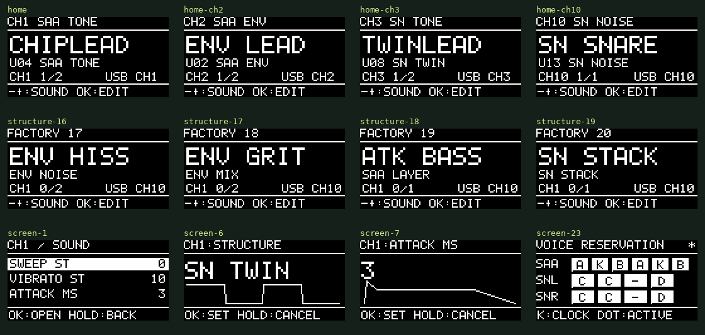

# Chiptune USB/CV firmware v0.8.1-alpha

SAA1099とSN76489AN×2をMIDIで演奏する、専用RP2040基板用のファームウェアです。音色を選んで弾き、3つのボタンで音を調整して保存できます。

**v0.8.1は、v0.8.0で初回起動が停止してOLEDとUSB MIDIを使えなくなる不具合を修正しています。** フラッシュの物理容量とアプリ用の範囲を分離し、起動時のフラッシュ書き込みを廃止しました。[復旧手順と検証内容](BOOT_RECOVERY.md)を参照してください。

v0.7以前の保存音色・8セットアップ・MIDI/CV/Gateルート・パターンは新しい割り当てへRAM内で初期化します。CV校正値と表示の明るさは保持します。**保存を実行するまでは、旧設定領域を書き換えません。** 有効なv0.8設定はそのまま読み込みます。

[**Wave Lab — Web MIDIエディタ**](https://bongorian.github.io/chiptune-usb-cv/) ／ [音色の構造・回路プロファイル](SOUND_DESIGN.md) ／ [SysEx仕様](protocol/README.md)

v0.8ではENV NOISE、ENV MIX、SAA LAYER、SN STACK、4つの回路配置プロファイルを追加しました。工場音色は20、USER音色は16枠です。v0.7の保存音色はRAM内で初期化し、明示的な保存で確定します。エディタの読み出し・反映にはv0.8以降が必要です。

## MIDIチャンネルと音源の基本配置

MIDIチャンネルは演奏パートです。チップ内部の発音回路を複数まとめて、一つの音色を演奏します。USB MIDIとTRS MIDIは、初期状態では同じ表を使います。

| MIDI ch | 役割 | 使う内部回路（1始まり） | 最大同時発音 | 初期音色 |
|---|---|---|---|---|
| **1** | SAA通常トーン | SAAの1・4 | 2声・左右PAN対応 | CHIPLEAD |
| **2** | SAA ENV/AM | 出力はSAAの3・6、クロックに2・5を予約 | 2声・左右PAN対応 | ENV LEAD |
| **3** | SNステレオトーン | 左右SNそれぞれのトーン1・2 | ステレオ2声 | TWINLEAD |
| **10** | SNステレオノイズ | 左右SNのノイズ。KEY TRACK/METALではトーン3も使用 | ステレオ1声 | SN SNARE |
| その他 | 未割り当て | — | — | — |

**ch1とch2へ同時にノートを送ると両方が鳴ります。ch3とch10も同時に使えます。** 初期配置は最大6声の楽音と1声のステレオノイズです。声数は全ハードウェアで無制限に増えるものではありません。SAAのENV用に2回路をクロック専用として使い、左右SNの同じ番号のトーンを組にしてステレオ1声を作ります。MONO/LEGATOの音色では、その予約枠のうち1声を使います。

SN2個の外部クロックは共通です。ch3でSNクロックFXを変えるとch10のノイズの性格にも作用します。これはMIDIルートとは別の、ハードウェア上の共有です。


- [UF2をダウンロード](dist/chiptune-v0.8.1-alpha.uf2)
- [OLED画面例](assets/ui-v08.png)
- [Androidからの更新](ANDROID_UPDATE.md)
- [ビルド検証](dist/Verification.json)／[テスト記録](dist/Test_Verification.json)
- [実機確認項目](BRINGUP.md)

専用基板向けです。Pico/Pico W用・RP2350用ではありません。alpha版のため、この版の実機での発音・OLED・USB接続の確認は未完了です。v0.5.1のOLED更新枠確保と通信再試行の修正を引き継いでいます。

## まずMIDIで弾く

1. UF2をBOOTSELの`RPI-RP2`へコピーします。更新中はOLEDが消えます。完了後、USBを抜き、ボタンを押さずに挿し直します。
2. 右下のJ3（LINE OUT）を外部アンプへ接続します。
3. USB MIDIまたはTRS Type A MIDIからノートを送ります。ch1でSAA通常トーン、ch2でENV、ch3でSN、ch10でノイズを演奏します。CV/Gateとシーケンサーは初期OFFです。
4. ホームの−／＋で音色を選びます。短いOKで音作り、OK長押しでメニューを開きます。

初回は旧保存内容を引き継がず、上の表へ統一します。更新後は古いMULTIとSINGLEで初期状態が変わることはありません。BOOTSELへ入る−/＋同時押しの復旧方法は維持しています。



## 3ボタン操作

| 場所 | −／＋ | 短いOK | OKを約0.7秒長押し |
|---|---|---|---|
| ホーム | 前／次の保存音色 | 音作りを開く | メニューを開く |
| メニュー・一覧 | 項目を選ぶ | 開く／編集開始 | 一つ戻る |
| 値の編集 | 値を変える | 確定 | 取り消す |
| 確認画面 | NO／YES | 選択を実行 | 取り消す |

編集するMIDIパートは、OK長押し → メニュー先頭の**EDIT CHANNEL**で選びます。これは編集先の切り替えで、MIDI受信先や他パートの発音は変わりません。ホームのフッターは通常操作と`HOLD OK:MENU`を交互に表示します。−／＋の長押しは連続移動・連続変更です。広い数値範囲では長押し時間に応じて加速します。

−と＋を約0.9秒同時長押しすると、全発音・試聴・シーケンスを停止するPANICです。USB接続時に−と＋を押しているとBOOTSELへ入ります。

## ホームの見方

上段が編集中のMIDIチャンネルと音源の役割、大きい文字が現在の音色名です。その下のU番号がUSER音色番号、その隣が音源方式です。`CH1 1/2`なら、受信先はch1、選択音色の使用声数は1／予約声数2です。複数の受信チャンネルがある場合はMULTI、ルートがなければNO MIDI、パートが無効ならPART OFFです。

右下には最近受信したUSB/TRS MIDIとチャンネルを短時間表示します。これは受信の表示で、発音が成功したことを表す表示ではありません。発音数と併せて、送信側のチャンネル違いを確認できます。USB+TRSは入力の接続先表示です。

ホームの`*`は現在の音色が保存音色から変わっている印です。編集後に別の音色へ切り替える場合は、破棄確認が出ます。NOなら現在の音色を保ちます。

## 音作りと保存

短いOKで開くSOUNDには、音源方式に合った主な値を先頭に並べます。

- SAA ENV／AM／ENV NOISE／ENV MIX／LAYER：実際の波形とステップ数。
- 通常のSAAトーン：スイープとビブラート。
- SN TWIN／片側SNトーン：デチューンとビブラート。
- ノイズ／メタル：ノイズレートまたはトーン混合率とディケイ。

ATTACK、RELEASE、LEVELも直接操作できます。`AMP ENVELOPE`にADSR・PAN、`STRUCTURE`に波形の詳細と音源方式の変更、`VOICE / PITCH`にPOLY/MONO/LEGATO、声数、グライド、音域があります。`MACROS / LFO`で4つのマクロの割り当てとLFOを編集できます。

ホームの音色選択は、現在のMIDIパートの役割に合う音色だけを巡回します。ch1では通常SAA・SAAノイズ/ミックス、ch2ではENV/AM/ENV NOISE/ENV MIX/LAYER、ch3ではSN TWIN/STACK、ch10ではSNノイズ/METALです。音色を切り替えても別のチップへ勝手に移りません。通常の音色切替は該当パートだけを停止し、影響のないパートは演奏を続けます。資源配置の変更で他パートの回路も移動する場合は、そのパートも停止します。全体PANIC、セットアップ読込、フラッシュ保存は全体を停止します。

保存はOK長押し → `SAVE SOUND`。USER SLOTとSOUND NAMEを決め、SAVE SOUNDの確認でYESを選びます。16枠を上書きでき、失敗時は元の内容へ戻します。

SAVE SOUNDでは音色枠と現在の全パートのセットアップを同時に保存します。確認画面にUSER番号とALL PARTSを表示します。次の起動で同じ音色配置・受信設定を復元します。別のセットアップ枠へ保存する場合は`PARTS / SETUP > SAVE / LOAD SETUP > SAVE SETUP`を使います。起動時を含め、自動保存はしません。

FACTORY SOUNDSから固定の工場音色を読み込めます。読み込むだけではUSER枠は変わらず、SAVE SOUNDで保存先を選べます。

| 工場音色 | 音源 | 特徴 |
|---|---|---|
| ENV BASS | SAA ENV | モノのENV発振ベース |
| ENV LEAD | SAA ENV | ENV発振とビブラート |
| STEP SAW | SAA ENV | 8ステップの下降波 |
| CHIPLEAD | SAA TONE | 基本の矩形波リード |
| SAA PLUK | SAA TONE | 短い減衰音 |
| AM BELL | SAA AM | キャリアとENVの振幅変調 |
| SOFT PAD | SAA TONE | 遅いアタックと長いリリース |
| TWINLEAD | SN TWIN | 左右のSNを使うデチューン音 |
| SN BASS | SN TWIN | モノと短いグライド |
| DETUNE | SN TWIN | 広めの左右デチューン |
| DRY SN | SN TWIN | 短いリリースの矩形波 |
| METAL | SN METAL | 周期ノイズとトーンの混合 |
| SN SNARE | SN NOISE | 減衰するホワイトノイズ |
| HI HAT | SN NOISE | 短いノイズ |
| SAA NOIS | SAA NOISE | アタックのあるノイズ |
| LASER | SN TWIN | 大きなピッチスイープ |
| ENV HISS（F17） | ENV NOISE | ノイズのハードウェア振幅変調 |
| ENV GRIT（F18） | ENV MIX | トーン＋ノイズのハードウェア振幅変調 |
| ATK BASS（F19） | SAA LAYER | ENV楽音＋短い補助トーン／ノイズ |
| SN STACK（F20） | SN STACK | 2／3組のステレオトーンを重ねる |

工場音色名は用途の目安です。実際の聴感は未評価です。旧設定からの移行時は、USER枠もRAM内でこの工場音色へ置き換えます。

## MIDI入力と複数音色

OK長押し → MIDI INPUTのRECEIVE CHで、選択音色のUSB/TRS受信チャンネルをまとめて指定します。値はOKで確定するまでルーティングを変えません。USBとTRSを別々に設定する場合はUSB ROUTING／TRS ROUTINGを使います。

Program Change 0〜15はUSER音色1〜16です。パートの音源役割と合わない音色への変更は拒否し、他チャンネルの音色も変えません。工場状態の対応は、ch1がPC 3/4/6/14、ch2がPC 0/1/2/5、ch3がPC 7/8/9/10/15、ch10がPC 11/12/13です。ここでPCは0始まり、画面のU番号は1始まりです。USER枠を上書きした場合は、その音色の音源方式に従います。CC16〜19はマクロ1〜4（−100〜+100）、CC1とプレッシャーは初期状態で楽音パートのビブラートへ割り当てます。ch10ではCC1がディケイ、プレッシャーが音量です。ピッチベンド、RPN 0、サステイン、ベロシティ曲線にも対応します。USB/TRSの同音ノートは所有元を区別します。

`PARTS / SETUP`のPART SETUPで有効化・声数・ENGINE ROLEを指定できます。基本配置ではENGINE ROLEがチップの役割を固定します。FREEにすれば音源方式の制限を外せますが、他パートとの資源競合は検査します。SINGLE PLAYは明示的な自由演奏モードへの切り替えで、他パートとCV/GateをOFFにします。通常の複数MIDIチャンネル演奏には使いません。MIDIルートを同じチャンネルから複数パートへ割り当てるとレイヤー、音域を分けるとスプリットになります。A〜Nは音色を置く演奏パートで、物理ICそのものの名前ではありません。利用できる声数は全パートで共有します。RESOURCE MAPに予約を表示します。

セットアップは音色の配置・MIDI/CV/Gate・パターン・SN共通クロックをまとめる8枠の保存単位です。

## ノイズ音色の確認

SNのNOISE RATEはFAST/MID/SLOW/KEY TRACKです。FAST〜SLOWは固定の分周比、KEY TRACKはトーン3をノイズ用クロックに使います。KEY TRACKは通常トーンの1声分も予約します。

v0.6.1では、KEY TRACKのホワイトノイズでMIDI音程を更新速度へ直接使っていた点を変更しました。低いノートを送ると、更新速度も数十Hzになり、低い段差やクリックのような音に偏っていました。ホワイトノイズでは更新用クロックを音程の32倍（+5オクターブ）にし、ノートはノイズの明るさを動かす入力として扱います。これは音色のマッピングで、ホワイトノイズに楽音としての基本周波数を保証するものではありません。周期ノイズの15倍換算は維持します。FAST〜SLOW、通常トーン、SAAノイズの音程変換は変更しません。

旧MULTI初期パートDにMIDI ch10のD2を送る例では、SNノイズの更新速度は約73Hzから約2.35kHzへ変わります。ホワイト/周期の切り替え、左右の音量、トーン3の分周値、再トリガー、SAAノイズの有効化と振幅を、送出レジスターを解釈するPCテストで確認します。実機の音声確認は未完了です。

最小の聴取テストは、固定レートのHI HATまたはSN SNAREをFACTORY SOUNDSから読み込み、TOOLS / AUDITIONでTESTをREPEATにします。これで固定レートのノイズとKEY TRACKを切り分けられます。これらは短い減衰音なので、HOLDで開始しても鳴り続けません。連続音として確認したい場合はAMP ENVELOPEのSUSTAINを100にしてからHOLDを使います。

## CV/Gate、パターン、SNクロック

追加の演奏手段はメニュー配下にあります。

- `MIDI INPUT > CV / GATE`：独立した2組のCV/Gate。CVはOFF/NOTE（1V/oct）/MOD、GateはOFF/NOTE/RETRIGGER/STEP/FX TRIGGER。対象パートは独立して選べます。
- `PARTS / SETUP > MOTION / SEQUENCE`：最大16ステップのNOTE/GATE/VELOCITY/MACRO1、アルペジオ、LFO・CV・CC・プレッシャーの変調マトリクス、テンポ・同期。
- SOUNDの`SN CLOCK: BOTH`：4/2/1MHz基準、MANUAL/RISE/TRIANGLE/SQUARE/RANDOM/SEQUENCE/DIVE。2個のSNは共通クロックです。音色枠には共通クロック設定を含まないため、必要ならセットアップとして保存します。

CV NOTEの音程が新鮮ならGateの音程に使い、それ以外はFIXED NOTEを使います。古いADC値や入力異常ではCV由来のノートをリリースします。0Vは正常値なのでケーブル抜けとは判定しません。校正はSYSTEM > CV CALIBRATIONです。

SAA ENVはFE/NEをOFFにし、ハードウェアENVの出力を楽音として使います。ENV用の周波数クロックにトーン2/5を予約し、出力は3/6（ともに1始まり）です。ENVとソフトADSRは独立です。16ステップ三角波の最高音は約488Hz、下降/上昇波は約977Hz、8ステップならそれぞれ倍です。範囲外の純ENV発振は無音にします。波形表示は設定から描く模式図です。

## ビルドと検証

```sh
cmake -S firmware -B build/tests -G Ninja -DCHIPTUNE_HOST_TESTS=ON -DCMAKE_BUILD_TYPE=Debug
cmake --build build/tests
ctest --test-dir build/tests --output-on-failure
bash firmware/tools/bootstrap_sdk.sh .deps/pico-sdk
cmake -S firmware -B build/firmware -G Ninja -DPICO_SDK_PATH="$PWD/.deps/pico-sdk" -DCMAKE_BUILD_TYPE=Release
cmake --build build/firmware -j4
python3 firmware/tools/verify_build.py build/firmware --output build/firmware/Verification.json
python3 -m pip install -r firmware/tests/requirements-arm.txt
python3 firmware/tests/check_arm_boot.py build/firmware/chiptune.elf --output build/firmware/Boot_Verification.json
```

Pico SDK 2.3.1を使います。保存形式はv6です。v1〜v5（v0.7を含む）からCV校正値を取り出し、音色・演奏設定は初回に置き換えます。v5からは明るさも保持します。USBは設定読み込み前に初期化します。設定移行はRAM内で行い、起動時には保存しません。SAVEの実行時に別のフラッシュバンクへコミットします。新しい構成リビジョンを読めた以後の起動では、ユーザー設定を保持します。末尾64KiBの設定領域は配布UF2に含めません。実機の音声・表示・USB電流・CV精度はPCテストとは別に確認します。
