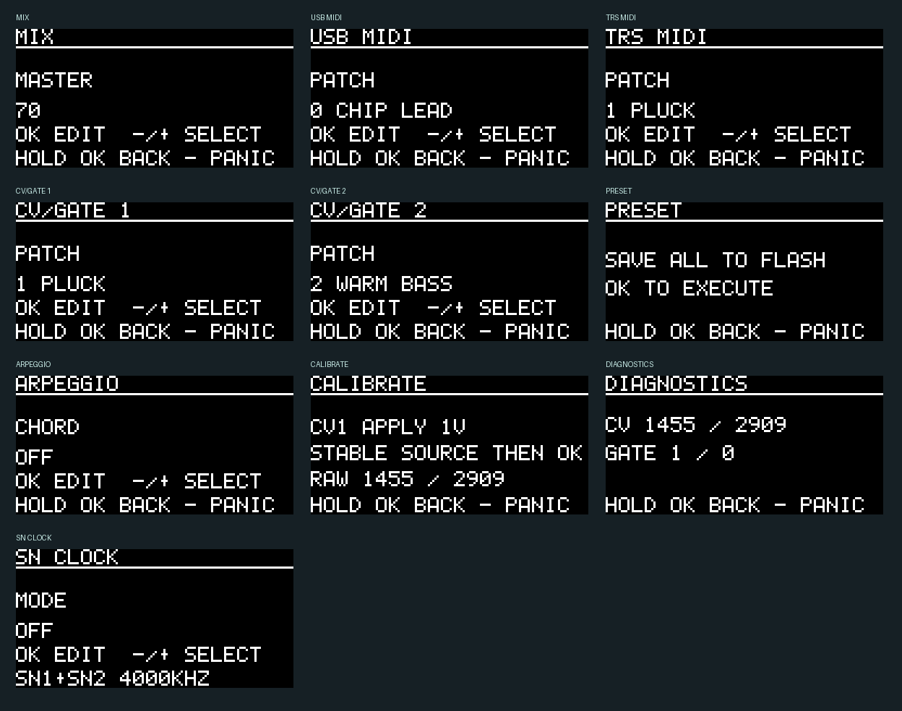

# Chiptune USB/CV firmware

SAA1099 × 1、SN76489AN × 2を実物の音源として使う、専用基板向けRP2040ファームウェアです。
音声は各ICのアナログ出力から出ます。RP2040は発音・音量・音程・ルーティングを制御します。

**v0.2.0-alpha — 実機評価用。** RP2040用UF2のビルドとPC上の自動テストを通過しています。
実基板での起動、USB列挙、音、消費電流、CV精度、OLED表示は未確認です。
最新の[ビルド検証記録](dist/Verification.json)、[テスト記録](dist/Test_Verification.json)と[初回動作確認手順](BRINGUP.md)を参照してください。

## 音源の使い分け

| 音源 | 使い方 | 管理する制約 |
|---|---|---|
| SAA1099 | 6声の矩形波、左右独立の音量、トーン＋ノイズ、ハードウェア包絡、動くステレオ定位 | 3声ごとの共有ノイズ生成器。包絡を使う声は専用のクロック用トーンを予約 |
| SN76489AN 1 | 左側の3声の矩形波＋1声のノイズ | 対数2 dB刻みの音量。音程付き周期ノイズでは第3トーンを予約 |
| SN76489AN 2 | 右側の3声の矩形波＋1声のノイズ | 左側とは独立して発音。音源クロックは2個共通。通常4 MHz、SN CLOCKで250 kHz–4 MHz |

通常のトーン＋ノイズで最大14声。CV予約、ハードウェア包絡、音程付きノイズによって空き声数は減ります。
CVを2声予約する初期設定では、MIDIに最大12声を割り当てられます。
SAA1099のノイズは既存の声に重ねる機能で、別の発音枠には数えません。

SAA1099の包絡は内部クロックを使います。Philipsのデータシートに従い、トーン2／5（0始まり）に包絡、トーン1／4に専用の70 Hzクロックを割り当てます。
異なるノイズ色を同じSAAの3声グループへ割り当てることは避けます。
クロック用の声は通常のMIDI発音から必要に応じて確保しますが、予約中または発音中のCVの声を奪いません。

SNの通常の矩形波の最低音は4 MHz時に約122.2 Hzです。低い音はAUTOでSAAを優先します。
範囲外の音程は分周器の上下限へクランプし、診断画面のカウンターに記録します。
PERIODICではSN76489A系の15段周期を前提にクロックを15倍に補正します。
実物ICの周期・誤差はチューナーやオシロスコープで確認してください。
SN1は左、SN2は右に固定されているため、MIDI PanはSAAの声に作用します。

## 音色

Program Changeは0–15、画面のPATCHも0始まりです。DAWが1始まり表示なら1–16に相当します。
選択した音源で使えない音色は発音を断り、DIAGNOSTICSのREFUSEDを増やします。

| PC | 名前 | 特徴 |
|---|---|---|
| 0 | CHIP LEAD | 短いアタック、遅れて入るビブラート |
| 1 | PLUCK | 減衰して消えるプラック |
| 2 | WARM BASS | 持続する矩形波ベース。低音はSAA向け |
| 3 | HW BELL | SAAの単発減衰包絡。SAA専用 |
| 4 | HW TRIANGLE | SAAの反復三角包絡と左右反転。矩形波を包絡で変調する音色 |
| 5 | STEREO PAD | 遅い立ち上がりと定位の移動 |
| 6 | TONE NOISE | SAAのトーン＋ノイズ。SAA専用 |
| 7 | WHITE SNARE | ホワイトノイズの短い減衰 |
| 8 | HI HAT | 高速ノイズの短い減衰 |
| 9 | PERIODIC | SNのトーン連動周期ノイズ。SN専用 |
| 10 | KICK | 音程が下がるキック |
| 11 | LASER | 大きなピッチ下降と定位の移動 |
| 12 | CHORUS | 声ごとに位相が異なるビブラート。LAYERでステレオの厚みを作る |
| 13 | SLOW ATTACK | 長いアタックとリリース |
| 14 | NOISE PAD | 持続するノイズと定位の移動 |
| 15 | DRY SQUARE | 短いリリースの矩形波 |

ADSRはソフトウェア制御、HW BELL／HW TRIANGLEは実ICの包絡も併用します。
SNの振幅は対数特性に合わせて変換し、最小音量より小さいレベルはミュートします。
ディレイ・リバーブや、矩形波の自由なデューティ変更は含みません。
音色の定義は[`src/engine.c`](src/engine.c)の`patches`です。

## SNクロックの音作り

[SN CLOCKの操作・音作り・CC一覧](SN_CLOCK.md)を参照してください。
2個のSNに共通の実クロックを250 kHz–4 MHzで動かし、RISE／DIVE、TRIANGLE／SQUARE、RANDOM、SEQUENCEを重ねられます。
ノイズ速度も変わり、SAAのクロックは独立して維持します。最高800 Hzの段階的な変調を選べます。
初期設定のプリセット5–8に使用例を収録しています。MODE OFFでは従来どおり4 MHzです。

## MIDI

USB MIDI 1.0デバイスと、TRS Type A MIDI入力を同時に受け付けます。
USB鍵盤の直接接続には対応しません。PC／USBホストから演奏するか、TRS MIDIを使ってください。

- USB／TRSごとに、入力チャンネル（OMNIまたは1–16）、AUTO／SAA／SN1／SN2／LAYER、初期音色を設定できます。
- LAYERはSAAの1声とSNの1声を重ねます。SN側はノート番号の偶奇で左右へ振り分けます。SAA専用音色はSAAだけで発音します。
- Note On／Off、Velocity、Program Change、Pitch Bend ±2半音を処理します。
- CC1 Modulation、CC7 Volume、CC10 Pan、CC11 Expression、CC64 Sustain、CC120 All Sound Off、CC121 Reset Controllers、CC123 All Notes Offを処理します。
- 同音の重複発音はFIFOでNote Offを対応付け、USBとTRSのNote Offを独立させます。声のスティール後に古いNote Offが別のノートを消すことを防ぎます。
- チャンネル10ではノート36＝KICK、38＝WHITE SNARE、42／44＝HI HATを選びます。GM全体の音色互換はありません。
- ランニングステータス、途中に入るリアルタイムメッセージ、SysExを扱うパーサーを備えます。SysExはローカル音源では解釈しません。
- TRSのTO USBをONにすると、入力をUSB MIDI INへ転送します。SysExとリアルタイムも転送対象で、ローカルのチャンネルフィルターとは独立です。
- UARTエラー、転送キューあふれ、Active Sensingの300 ms超の途切れは消音・パーサー再同期で処理します。転送エラーではUSB側へCC120を送り直します。

ARPEGGIOは、押した各ノートを根音としたメジャー／マイナー／オクターブの4ステップ音程変化です。
コードの構成音を記憶して巡回するアルペジエーターではありません。
選択したUSB／TRSのMIDI Clockを使い、Start／Continue／Stopに応答します。
クロックが来ない場合は120 BPM相当で走ります。CLOCKS/STEPは1–16、初期値4です。
Stopではステップを停止し、持続中の発音は残します。

## CV／ゲート

ADS1115の差動AIN0–AIN1、AIN2–AIN3を交互に読みます。
PGAは±2.048 V、860 SPSの単発変換で、読み出し待ちは状態機械で行います。
ADCの最大変換速度だけで考えると各入力の上限は430サンプル/秒で、実際はI2C・描画・発音処理の時間が加わります。
ゲートはGPIO割り込みで立ち上がり／立ち下がりをキューに記録し、直近のCVを使います。
ADCが不調または100 ms以上古い場合は、そのCVの声をリリースします。

入力ごとにENABLE、VOICE、PATCH、0V NOTEを設定できます。
基準音を0 Vのノート番号として、1 Vにつき12半音を加えます。
初期設定はCV1＝声0・PLUCK、CV2＝声6・WARM BASS、0 V＝MIDI 48（C3）です。

| VOICE番号 | 出力先 |
|---|---|
| 0–5 | SAAトーン1–6。HW包絡を使えるのは2／5 |
| 6–8 | SN1トーン1–3、左 |
| 9–11 | SN2トーン1–3、右 |
| 12 | SN1ノイズ、左。PERIODICでは声8も必要 |
| 13 | SN2ノイズ、右。PERIODICでは声11も必要 |

DIAGNOSTICSのCV RESERVEをONにするとCV用の声をMIDIから予約します。
OFFでは最後のNote On／ゲート立ち上がりを優先します。
継続するCVの音程更新だけで、MIDIの新しいノートを奪い返すことはありません。
2つのCVへ同じ声を割り当てる操作は避け、声に適合する音色だけを選べるようにしています。

校正は、CALIBRATEで入力ごとに正確な0 Vを加えてOK、その後正確な1 Vを加えてOKです。
各段階で少なくとも0.5秒程度安定させてから操作してください。
直近64サンプルの標準偏差が4コードを超える場合や、0 Vのオフセットが大きい場合、利得が異常な場合はCAL FAILEDになります。
成功後にPRESETのSAVEでフラッシュへ保存してください。0 Vだけの未完了校正では保存を断ります。
校正値は全プリセット共通です。

## 画面・ボタン



上の画像は実際のUI描画コードから作った画面です。モジュール上での表示確認は未完了です。

| 操作 | 動作 |
|---|---|
| ホームで−／＋ | メニューを選択 |
| OKを短押し | メニューに入る／値を編集／編集を終える／表示された操作を実行 |
| メニューで−／＋ | 項目を選択。編集時は値を変更 |
| 編集時に−／＋を長押し | 値を連続変更 |
| OKを0.7秒長押し | ホームへ戻る |
| 編集中以外に−を0.7秒長押し | 全音源のPANIC（消音） |
| 電源投入時に−と＋を同時押し | USB ROMブートローダーへ入る |

MIXは発音を続けたまま変更できます。ルーティング・CV設定・プリセットの変更は発音を消音して反映します。
PRESETは8枠を持ち、SLOT選択、SAVE、LOAD、INITを備えます。
SAVEでは現在の設定を選択スロットへ入れ、8枠全部・選択枠・CV校正をまとめて保存します。
INITはRAM上の初期化で、SAVEするまでフラッシュには書き込みません。
保存中は消音し、受信の途中状態を捨てます。演奏中の保存は避けてください。

DIAGNOSTICSでは声のスティール、発音を断った回数、音程クランプ、CV生値・ゲート、音源更新の最大処理時間・更新遅れ、UARTエラー・USB転送落ちを表示します。
ボタンは20 msのデバウンス、OLEDは16バイトずつの分割転送で、ADCと発音処理を優先します。

## 電源・保存

USB構成記述子は500 mAを要求します。USB構成が済むか、CCで1.5 A／3 A相当の供給広告を250 ms検出した後に、5 V音源電源を有効にします。
CCは基板の1/2分圧を戻し、公称0.68 Vで判定します。通常電流広告のUSB-A充電器だけでは起動しません。
PCで構成された後のサスペンドでは、音源・表示・LEDを止め、CPUは割り込み待ちへ入ります。
起動・動作・サスペンド電流、突入電流、CCの実測閾値は実基板での評価が必要です。USB適合検証済みではありません。

電源OFF時は音源のバス・制御・クロックをHi-Zにし、給電後にクロックを開始して全ICをミュートします。
SAAはDTACK待ちを使わず、データシートの固定待ち時間を満たす書き込みを行います。
SNはREADYが基板に接続されていないため、クロック設定の最も遅い条件からWE保持を16–136 µsに計算し、前後にも待ちを入れます。

フラッシュの最後の8 KiBを、2つの4 KiB設定バンクに予約します。
CRC、版、長さ、連番、設定値を検査し、新バンクのコミットマーカーを最後に書きます。
保存が途中で途切れたときは旧バンクを使い、両方無効なら初期設定で起動します。
リンカーのアプリ領域は2 MiB−8 KiBに制限しています。
保存形式はv2です。CRCと値が正しいv0.1形式を読み込み、既存の音色・ルーティング・校正を保ってSN CLOCKをOFFに移行します。
移行はRAM上で行い、SAVEするまで旧バンクは書き換えません。v0.1への戻しではv2形式を読めません。

## 書き込み

[ビルド済みUF2](dist/chiptune-v0.2.0-alpha.uf2)を使います。
初回は空のフラッシュからRP2040のUSB ROMブートローダーに入ります。
以後は−と＋を押しながらUSBを接続し、`RPI-RP2`へUF2をコピーしてください。
通常のUF2は設定領域を含みません。全フラッシュ消去や保存形式変更時は設定が失われます。

このUF2は専用基板のGPIO配線と2 MiBフラッシュ用です。一般のRaspberry Pi Pico向けには使わないでください。
開発用USB VID/PIDは`0xcafe:0x4008`です。配布製品では割り当てを受けた値に変更してください。

## ビルドとテスト

Pico SDK 2.3.1、TinyUSBとpicotoolのコミットを固定しています。[依存関係](DEPENDENCIES.md)を参照してください。
CMake 3.20以上、Ninja、Git、Python 3、Arm GNU Toolchain＋newlib＋C++ヘッダーが必要です。
Ubuntu 24.04では`gcc-arm-none-eabi libnewlib-arm-none-eabi libstdc++-arm-none-eabi-dev`などを使用できます。
SDKの例外・C++動的確保オーバーライドを無効にし、Cでリンクするため、巨大な`libstdc++-arm-none-eabi-newlib`は必要ありません。

リポジトリのルートで実行します。

```bash
bash firmware/tools/bootstrap_sdk.sh .deps/pico-sdk
cmake -S firmware -B build/firmware -G Ninja \
  -DPICO_SDK_PATH="$PWD/.deps/pico-sdk" -DCMAKE_BUILD_TYPE=Release
cmake --build build/firmware -j4
```

出力は`build/firmware/chiptune.uf2`です。
カスタムツールチェーンは`-DPICO_TOOLCHAIN_PATH=/path/to/toolchain`で指定できます。

```bash
cmake -S firmware -B build/tests -G Ninja -DCHIPTUNE_HOST_TESTS=ON
cmake --build build/tests
ctest --test-dir build/tests --output-on-failure
```

PCテストではASan／UBSanを有効にします。MIDIの所有権・重複ノート・声の奪取・共有リソース・CV校正・クロック・電源ポリシー・画面操作・破損／途中保存を検査します。
30,000件のMIDIイベントと5,000件のボタン操作によるストレステストも含みます。

## 構成

- `src/engine.*`：発音、音色、声の割り当て、音源レジスター変換。
- `src/sn_clock.*`／`pio/sn_clock.pio`：共有SN実クロックの変調と波形生成。
- `src/midi.*`：USB／UART共通のストリーム解析。
- `src/cv.*`：CV音程変換と校正。
- `src/ui.*`：3ボタン操作と128×64画面。
- `src/store.*`：保存レコードとCRC、バンク選択。
- `src/power.*`：音源電源の許可条件。
- `src/main.c`：基板固有のGPIO、PWM、I2C、USB、UART、フラッシュ処理。
- `pinmap.h`／`sound_bus.h`：基板のGPIOとデータバスのビット順。

音源の制御には次の一次資料を参照しています。
[Philips SAA1099（May 1985、1986 IC01 pp.141–158）](https://bitsavers.org/components/philips/_dataBooks/1986_IC01_Philips_Radio_Audio_and_Associated_Systems.pdf)、
[TI SN76489AN](https://map.grauw.nl/resources/sound/texas_instruments_sn76489an.pdf)、
[TI ADS1115](https://www.ti.com/product/ADS1115)、
[RP2040 datasheet](https://datasheets.raspberrypi.com/rp2040/rp2040-datasheet.pdf)、
[Pico SDK](https://github.com/raspberrypi/pico-sdk/tree/079c6f39023649b154152db30f1d781e884879bc)。
