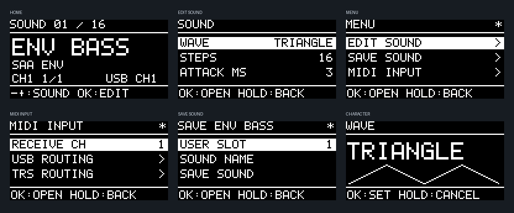

# Chiptune USB/CV firmware v0.6.1-alpha

SAA1099とSN76489AN×2をMIDIで演奏する、専用RP2040基板用のファームウェアです。音色を選んで弾き、3つのボタンで音を調整して保存できます。

- [UF2をダウンロード](dist/chiptune-v0.6.1-alpha.uf2)
- [OLED画面例](assets/ui-v06.png)
- [Androidからの更新](ANDROID_UPDATE.md)
- [ビルド検証](dist/Verification.json)／[テスト記録](dist/Test_Verification.json)
- [実機確認項目](BRINGUP.md)

専用基板向けです。Pico/Pico W用・RP2350用ではありません。alpha版のため、この版の実機での発音・OLED・USB接続の確認は未完了です。v0.5.1のOLED更新枠確保と通信再試行の修正を引き継いでいます。

## まずMIDIで弾く

1. UF2をBOOTSELの`RPI-RP2`へコピーします。更新中はOLEDが消えます。完了後、USBを抜き、ボタンを押さずに挿し直します。
2. 右下のJ3（LINE OUT）を外部アンプへ接続します。
3. USB MIDIまたはTRS Type A MIDIからノートを送ります。新規・旧形式からの初期状態は**MIDI ch1の1音色**です。CV/GateとシーケンサーはOFFです。
4. ホームの−／＋で音色を選びます。短いOKで音作り、OK長押しでメニューを開きます。

v0.5で保存済みのセットアップは、音色・ルーティング・CV/Gateを保ったまま読み込みます。ホームにMULTIと出る場合、OK長押し → `PARTS / SETUP > SINGLE PLAY > YES`で、選択パートを使った1音色の演奏に切り替えられます。この操作は他パート・CV/Gate・シーケンサーをOFFにし、USB/TRSを同じ受信チャンネルへまとめます。保存するまではフラッシュを書き換えません。



## 3ボタン操作

| 場所 | −／＋ | 短いOK | OKを約0.7秒長押し |
|---|---|---|---|
| ホーム | 前／次の保存音色 | 音作りを開く | メニューを開く |
| メニュー・一覧 | 項目を選ぶ | 開く／編集開始 | 一つ戻る |
| 値の編集 | 値を変える | 確定 | 取り消す |
| 確認画面 | NO／YES | 選択を実行 | 取り消す |

ホームのフッターは通常操作と`HOLD OK:MENU`を交互に表示します。−／＋の長押しは連続移動・連続変更です。広い数値範囲では長押し時間に応じて加速します。

−と＋を約0.9秒同時長押しすると、全発音・試聴・シーケンスを停止するPANICです。USB接続時に−と＋を押しているとBOOTSELへ入ります。

## ホームの見方

大きい文字が現在の音色名、その下が音源方式です。`CH1 1/2`なら、受信先はch1、選択音色の使用声数は1／予約声数2です。複数の受信チャンネルがある場合はMULTI、ルートがなければNO MIDI、パートが無効ならPART OFFです。

右下には最近受信したUSB/TRS MIDIとチャンネルを短時間表示します。これは受信の表示で、発音が成功したことを表す表示ではありません。発音数と併せて、送信側のチャンネル違いを確認できます。USB+TRSは入力の接続先表示です。

ホームの`*`は現在の音色が保存音色から変わっている印です。編集後に別の音色へ切り替える場合は、破棄確認が出ます。NOなら現在の音色を保ちます。

## 音作りと保存

短いOKで開くSOUNDには、音源方式に合った主な値を先頭に並べます。

- SAA ENV／AM：実際の波形とステップ数。
- 通常のSAAトーン：スイープとビブラート。
- SN TWIN／片側SNトーン：デチューンとビブラート。
- ノイズ／メタル：ノイズレートまたはトーン混合率とディケイ。

ATTACK、RELEASE、LEVELも直接操作できます。`AMP ENVELOPE`にADSR・PAN、`WAVE DETAILS`に波形の詳細と音源方式の変更、`VOICE / PITCH`にPOLY/MONO/LEGATO、声数、グライド、音域があります。`MACROS / LFO`で4つのマクロの割り当てとLFOを編集できます。

音色を変えると、SINGLEでは方式に合わせて声を割り当てます。MONO/LEGATOは1声、SAAトーンは最大6声、SAA ENV/AMは最大2声、SN TWINはステレオ3声、SNノイズ／メタルは1声です。MULTIでは他パートとの資源共有を考慮し、収まらなければ変更を拒否します。資源の再割り当て時は発音が止まる場合があります。

保存はOK長押し → `SAVE SOUND`。USER SLOTとSOUND NAMEを決め、SAVE SOUNDの確認でYESを選びます。16枠を上書きでき、失敗時は元の内容へ戻します。

SINGLEでは音色の保存と同時に現在の演奏セットアップも保存し、再起動後に同じ音色・受信設定で弾けるようにします。MULTIでは音色保存は選択パートの音色のみです。全体を保存するには`PARTS / SETUP > SAVE / LOAD SETUP > SAVE SETUP`を使います。自動保存はしません。

FACTORY SOUNDSから固定の工場音色を読み込めます。読み込むだけではUSER枠は変わらず、SAVE SOUNDで保存先を選べます。

| 工場音色 | 音源 | 特徴 |
|---|---|---|
| ENV BASS | SAA ENV | モノのENV発振ベース |
| ENV LEAD | SAA ENV | ENV発振とビブラート |
| STEP SAW | SAA ENV | 8ステップの下降波 |
| CHIPLEAD | SAA TONE | 基本の矩形波リード |
| SAA PLUK | SAA TONE | 短い減衰音 |
| AM BELL | SAA AM | キャリアとENVの振幅変調 |
| SOFT PAD | SAA TONE | 遅いアタックと長いリリース |
| TWINLEAD | SN TWIN | 左右のSNを使うデチューン音 |
| SN BASS | SN TWIN | モノと短いグライド |
| DETUNE | SN TWIN | 広めの左右デチューン |
| DRY SN | SN TWIN | 短いリリースの矩形波 |
| METAL | SN METAL | 周期ノイズとトーンの混合 |
| SN SNARE | SN NOISE | 減衰するホワイトノイズ |
| HI HAT | SN NOISE | 短いノイズ |
| SAA NOIS | SAA NOISE | アタックのあるノイズ |
| LASER | SN TWIN | 大きなピッチスイープ |

工場音色名は用途の目安です。実際の聴感は未評価です。古い版の保存済みUSER音色は上書きしないため、その場合は旧音色名が残ります。

## MIDI入力と複数音色

OK長押し → MIDI INPUTのRECEIVE CHで、選択音色のUSB/TRS受信チャンネルをまとめて指定します。値はOKで確定するまでルーティングを変えません。USBとTRSを別々に設定する場合はUSB ROUTING／TRS ROUTINGを使います。

Program Change 0〜15はUSER音色1〜16です。CC16〜19はマクロ1〜4（−100〜+100）、CC1とプレッシャーは初期状態でビブラートです。ピッチベンド、RPN 0、サステイン、ベロシティ曲線にも対応します。USB/TRSの同音ノートは所有元を区別します。

`PARTS / SETUP`で選択パートを変え、PART SETUPで有効化・声数を指定できます。MIDIルートを同じチャンネルから複数パートへ割り当てるとレイヤー、音域を分けるとスプリットになります。A〜Nは音色を置く演奏パートで、物理ICそのものの名前ではありません。利用できる声数は全パートで共有します。RESOURCE MAPに予約を表示します。

セットアップは音色の配置・MIDI/CV/Gate・パターン・SN共通クロックをまとめる8枠の保存単位です。

## ノイズ音色の確認

SNのNOISE RATEはFAST/MID/SLOW/KEY TRACKです。FAST〜SLOWは固定の分周比、KEY TRACKはトーン3をノイズ用クロックに使います。KEY TRACKは通常トーンの1声分も予約します。

v0.6.1では、KEY TRACKのホワイトノイズでMIDI音程を更新速度へ直接使っていた点を変更しました。低いノートを送ると、更新速度も数十Hzになり、低い段差やクリックのような音に偏っていました。ホワイトノイズでは更新用クロックを音程の32倍（+5オクターブ）にし、ノートはノイズの明るさを動かす入力として扱います。これは音色のマッピングで、ホワイトノイズに楽音としての基本周波数を保証するものではありません。周期ノイズの15倍換算は維持します。FAST〜SLOW、通常トーン、SAAノイズの音程変換は変更しません。

旧MULTI初期パートDにMIDI ch10のD2を送る例では、SNノイズの更新速度は約73Hzから約2.35kHzへ変わります。ホワイト/周期の切り替え、左右の音量、トーン3の分周値、再トリガー、SAAノイズの有効化と振幅を、送出レジスターを解釈するPCテストで確認します。実機の音声確認は未完了です。

最小の聴取テストは、固定レートのHI HATまたはSN SNAREをFACTORY SOUNDSから読み込み、TOOLS / AUDITIONでTESTをREPEATにします。これで固定レートのノイズとKEY TRACKを切り分けられます。これらは短い減衰音なので、HOLDで開始しても鳴り続けません。連続音として確認したい場合はAMP ENVELOPEのSUSTAINを100にしてからHOLDを使います。

## CV/Gate、パターン、SNクロック

追加の演奏手段はメニュー配下にあります。

- `MIDI INPUT > CV / GATE`：独立した2組のCV/Gate。CVはOFF/NOTE（1V/oct）/MOD、GateはOFF/NOTE/RETRIGGER/STEP/FX TRIGGER。対象パートは独立して選べます。
- `PARTS / SETUP > MOTION / SEQUENCE`：最大16ステップのNOTE/GATE/VELOCITY/MACRO1、アルペジオ、LFO・CV・CC・プレッシャーの変調マトリクス、テンポ・同期。
- SOUNDの`SN CLOCK: BOTH`：4/2/1MHz基準、MANUAL/RISE/TRIANGLE/SQUARE/RANDOM/SEQUENCE/DIVE。2個のSNは共通クロックです。音色枠には共通クロック設定を含まないため、必要ならセットアップとして保存します。

CV NOTEの音程が新鮮ならGateの音程に使い、それ以外はFIXED NOTEを使います。古いADC値や入力異常ではCV由来のノートをリリースします。0Vは正常値なのでケーブル抜けとは判定しません。校正はSYSTEM > CV CALIBRATIONです。

SAA ENVはFE/NEをOFFにし、ハードウェアENVの出力を楽音として使います。ENV用の周波数クロックにトーン1/4を予約し、出力は2/5です。ENVとソフトADSRは独立です。16ステップ三角波の最高音は約488Hz、下降/上昇波は約977Hz、8ステップならそれぞれ倍です。範囲外の純ENV発振は無音にします。波形表示は設定から描く模式図です。

## ビルドと検証

```sh
cmake -S firmware -B build/tests -G Ninja -DCHIPTUNE_HOST_TESTS=ON -DCMAKE_BUILD_TYPE=Debug
cmake --build build/tests
ctest --test-dir build/tests --output-on-failure
bash firmware/tools/bootstrap_sdk.sh .deps/pico-sdk
cmake -S firmware -B build/firmware -G Ninja -DPICO_SDK_PATH="$PWD/.deps/pico-sdk" -DCMAKE_BUILD_TYPE=Release
cmake --build build/firmware -j4
python3 firmware/tools/verify_build.py build/firmware --output build/firmware/Verification.json
```

Pico SDK 2.3.1を使います。設定形式はv5を維持し、v1〜v5の保存内容とCV校正を読み込みます。末尾64KiBの設定領域は配布UF2に含めません。実機の音声・表示・USB電流・CV精度はPCテストとは別に確認します。
