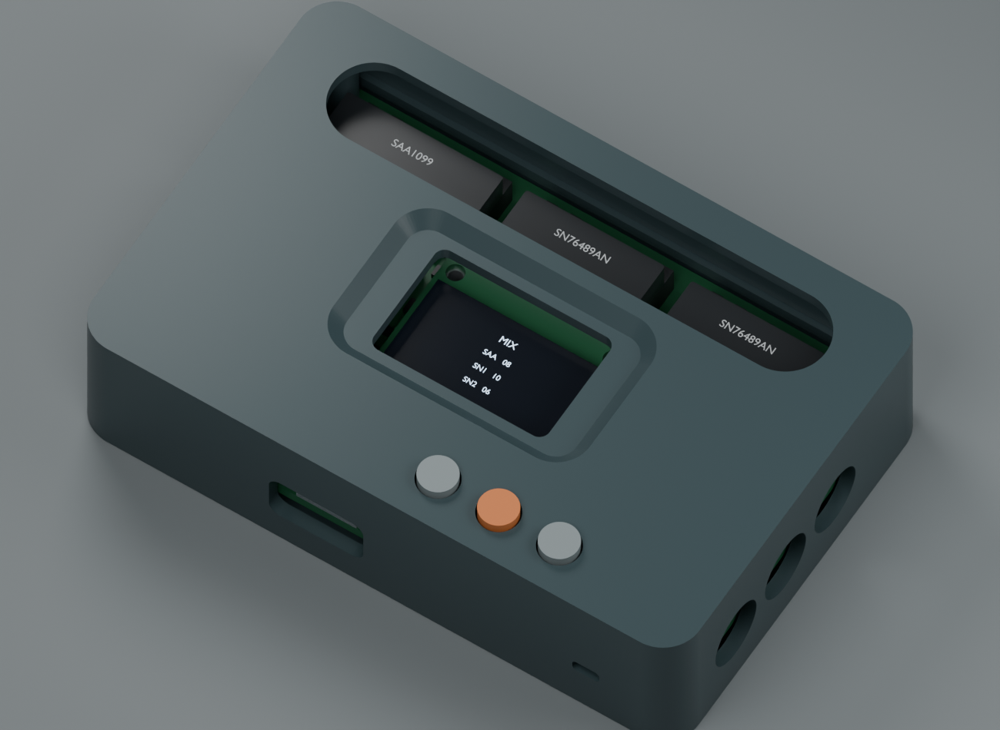

# Chiptune USB/CV enclosure

85 × 54 mmのChiptune USB/CV基板用の、FDM 3Dプリント向けケースです。
上下2分割、底面からのネジ止め、音源IC窓、OLED窓、3個の押し子を備えます。ケースに刻印はありません。



## 寸法と取り付け

| 項目 | 設計値 |
|---|---|
| ケース本体 | 89.8 × 58.8 × 23.0 mm |
| ボタンを含む最大高さ | 24.2 mm |
| 外周壁・底板 | 2.0 mm |
| 外形の角 | R5.4、基板の角R・取り付け穴と同心 |
| PCB底面 | ケース底から6.0 mm |
| ケース固定 | M2 × 10 mmネジ4本、M2熱圧入インサート4個 |
| インサートの想定外径・長さ | 外径3.5 mm、長さ3.0 mm |
| インサート下穴 | 直径3.2 mm、圧入部分深さ3.4 mm |
| OLED | 別モジュール、基板上の4穴に5 mmスペーサーで取り付け |
| ジャック開口 | 直径9.5 mm。奥にある端子までプラグの根元を通すための開口 |
| USB開口 | 14 × 8 mm、角丸 |
| ボタン | 直径5.4 mm、ガイド穴5.9 mm、押し子3個 |

OLEDの取り付けは基板側で完結します。蓋への固定や基板変更は不要です。
表示窓の周囲を2 mm下げ、斜面のベゼルで画面までの距離を減らしています。
底面にはBOOT／RESETサービスパッドへのアクセス穴があります。SWDは蓋を外してアクセスします。

## 印刷ファイル

印刷パーツと編集用データは`exports/Chiptune_Enclosure_3DPrint.zip`にまとめています。

STLはmm単位で、推奨する印刷面がZ=0になるように出力しています。
スライサーへ読み込む際に自動で別方向へ回転させないでください。

| ファイル | 数量 | 配置 |
|---|---|---|
| [`base.stl`](exports/base.stl) | 1 | 底面をベッドへ |
| [`lid.stl`](exports/lid.stl) | 1 | ケース上面をベッドへ。ガイド・柱が上向き |
| [`button_cap.stl`](exports/button_cap.stl) | 3 | ボタン表面をベッドへ |
| [`fit_coupon.stl`](exports/fit_coupon.stl) | 任意1 | 下穴とガイドの嵌め合い確認用 |

0.4 mmノズル、0.2 mm積層、壁4周以上、インフィル25–35%を初期設定とします。
ケースと押し子はPETGを想定しています。PLAでも形状確認は可能です。
ケースはサポートなしを想定した形状です。押し子のフランジには約1 mmの張り出しがあり、
プリンタによってブリムや局所サポートが必要になる場合があります。
インサート柱は高いインフィル密度にするか、局所設定でソリッドにしてください。

先に試し刷りパーツと押し子1個を印刷し、インサートとガイドを確認します。
試し刷りパーツの浅い穴は、`board_features.json`のXY方向で左から2.9／3.0／3.1／3.2／3.3 mmです。
貫通穴は左から5.7／5.9／6.1 mmです。穴の順序は[`組み立て図`](previews/mechanical_drawing.svg)にも示しています。
採用した穴径を`parameters.json`に反映して再生成できます。

## 開口

音源ICとOLEDはカバーのない開口から直接見える構成です。
透明板・窓用接着剤・透明フィラメントの導光部品は使用しません。
OLEDモジュール自体の表示ガラスをそのまま使用します。

| 開口 | 寸法 |
|---|---|
| 音源IC | 73 × 12 mm、両端R6 |
| OLED | 26 × 17 mm、角R1.5。表示領域の中心に配置 |
| 状態LED | 手前側面に4 × 2 mm、角R0.7の直接確認用スリット |

## 組み立て

1. 試し刷りパーツで圧入穴径を確認し、蓋の4本の柱にインサートを圧入する。
2. 基板に音源ICとソケット、OLEDモジュールを取り付ける。OLEDには5 mmのM2スペーサー4個を使用する。
3. 押し子3個を蓋の内側からガイドへ差し込む。
4. 基板を底ケースの4本の支柱に載せる。裏面のピン・はんだが底板に触れないことを確認する。
5. 蓋を合わせ、底面からM2 × 10 mmネジ4本で固定する。

ケース固定ネジはすべてインサートへ入ります。樹脂へのタッピングや、別体のケース用ナットは使いません。
OLEDの取り付けには、基板設計で指定する5 mmのねじ付きスペーサーとモジュール用ネジを使用します。
ボタンは無荷重でスイッチが押されない状態に調整してください。必要なら`button_max_up_gap_mm`を変更して押し子を再出力します。

## ポート配置

基板を上から見て、音源ICの列を奥、USBとボタンの列を手前に置いた方向です。

| 位置 | 奥から手前の順 |
|---|---|
| 左側 | CV1、GATE1、TRS MIDI IN Type A |
| 右側 | CV2、GATE2、ステレオLINE OUT |
| 手前 | USB-C、−／決定／＋の3ボタン、状態LED |

## 設計データ

- [`assembly.step`](exports/assembly.step): ケース・基板・OLED・押し子の位置関係。
- `exports/base.step`、`lid.step`、`button_cap.step`: 個別の編集用ソリッド。
- [`enclosure_preview.blend`](exports/enclosure_preview.blend): 外観確認用Blenderシーン。
- [`build_enclosure.py`](build_enclosure.py): CadQueryによるパラメトリック設計。
- [`parameters.json`](parameters.json): 壁厚、インサート下穴、表示窓、ボタンなどの寸法。
- [`board_features.json`](board_features.json): KiCadから取得した取り付け位置とPCBのハッシュ。
- [`mechanical_verification.json`](mechanical_verification.json): 干渉とSTL形状の検査結果。

```bash
# KiCad pcbnewを利用できるPythonで基板位置を抽出
/usr/bin/python3 mechanical/extract_board.py
# 依存ライブラリのインストール
python -m pip install -r mechanical/requirements.txt
# CadQuery / trimeshを利用できるPythonで生成
python mechanical/build_enclosure.py
# Blenderでプレビューを生成
blender --background --python-exit-code 1 --python mechanical/render_enclosure.py
# 寸法図と印刷用ZIPを生成
python mechanical/make_drawing.py
python mechanical/package_enclosure.py
```

依存ライブラリは[`requirements.txt`](requirements.txt)を参照してください。
CadQueryの操作は[公式ドキュメント](https://cadquery.readthedocs.io/en/latest/)を参照できます。

## 寸法検証の範囲

基板の穴、ジャック、USB、ボタンのXY位置は配線済みKiCadデータから取得しています。
OLEDはHS96L03W2C03（27.3 × 27.8 mm、穴間23.3 × 23.8 mm）のメーカー図面を基準としています。
別仕様の0.96インチモジュールへ交換する場合は、穴と表示領域の位置を合わせて変更してください。

ソケット＋DIP ICの高さはPCB上12.0 mm以下を想定し、蓋の裏面まで1.4 mmを確保しています。
OLEDの裏面部品は1.0 mm、前面はモジュールPCB上1.9 mm、スイッチ高さは1.5 mmを想定しています。
これらは現物の測定値ではありません。押し子の足はスイッチのカバー面をストッパーにする設計で、
実際のストロークとカバー形状を仮組みで確認します。

ソリッドの干渉検査とSTLの閉じた形状の検査は完了しています。
印刷収縮、圧入後の変形、実物のソケット高さ、プラグ外径、発熱の評価は試作後に行う必要があります。
プレビューの基板部品は機械的な外形モデルで、実装品の写真ではありません。

## 寸法の出典

- OLED: HS96L03W2C03メーカー図面（基板の設計資料と同じモジュール）。
- ジャック: HRO PJ-320Dメーカー図面。
- USB-C: HRO TYPE-C-31-M-12メーカー図面、[C165948](https://jlcpcb.com/partdetail/C165948)。
- スイッチ: XKB TS-1187Aシリーズ図面、[メーカー製品ページ](https://www.helloxkb.com/Home/Goods/goodsInfoxq/id/1913)。
